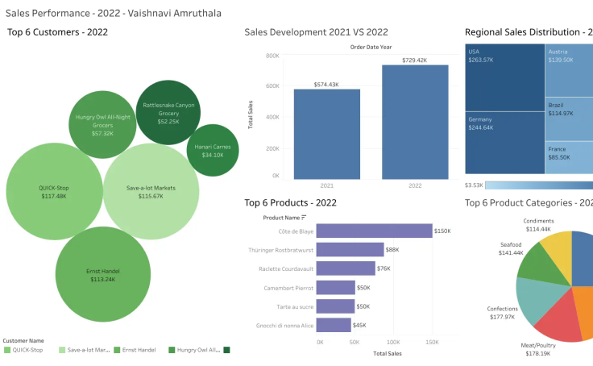
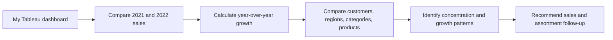

# Sales Performance Analysis — 2022

**My focus:** Sales Analytics

## Executive summary

My analysis reviews the dashboard’s 2021–2022 sales pattern and compared customer, product, category, and regional contributions. My dashboard shows sales rising from **$574.43K** in 2021 to **$729.42K** in 2022, about **26.97%** year-over-year growth.

## Business question and pipeline

Business question: how did sales change in 2022, and which customers, products, categories, and regions contributed most?

## Business KPIs

| Metric | Formula | Dashboard value | My interpretation |
|---|---|---:|---|
| Total sales | `SUM([Product_Order_Price_Total])` | 2021 **$574.43K**; 2022 **$729.42K** | My analysis uses this as the top-line sales measure for each year. |
| Year-over-year growth | `(2022 sales − 2021 sales) ÷ 2021 sales × 100` | **26.97%** | I read this as the relative increase in sales from 2021 to 2022. It does not measure margin growth. |
| Customer sales | `SUM([Product_Order_Price_Total])` by customer, filtered to 2022 | QUICK-Stop **$117.48K**; Save-a-lot **$115.67K**; Ernst Handel **$113.24K**; Hungry Owl **$57.32K**; Rattlesnake Canyon **$52.25K**; Hanari Carnes **$34.10K** | My analysis uses the ranking to see which accounts contribute most to 2022 sales. |
| Regional sales | `SUM([Product_Order_Price_Total])` by region | USA **$263.57K**; Germany **$244.64K**; Austria **$139.50K** | Comparisons cover displayed sales concentration across regions. |
| Category sales | `SUM([Product_Order_Price_Total])` by category | Beverages **$286.53K**; Dairy **$251.33K**; Meat/Poultry **$178.19K**; Confections **$177.97K**; Seafood **$141.44K**; Condiments **$114.44K** | Comparisons cover category contribution to sales; sales are not the same as contribution margin. |
| Product sales | `SUM([Product_Order_Price_Total])` by product, top six in 2022 | Côte de Blaye **~$150K**; Thüringer Rostbratwurst **~$88K**; Raclette Courdavault **~$76K**; Camembert Pierrot **~$50K**; Tarte au sucre **~$50K**; Gnocchi di nonna Alice **~$45K** | I rank products by sales value, not units or profit. |

## Model Metrics

The analysis used a descriptive dashboard rather than a predictive model, so accuracy, AUC, and prediction error do not apply.

## Insights and recommendations

- The analysis found sales grew about **27%** year over year.
- The dashboard shows the largest displayed regional totals in the USA and Germany, and the largest category totals in Beverages and Dairy.
- Recommended action: reviewing the six leading customer accounts and tracking concentration alongside sales growth.
- Recommended action: using category and product sales to guide assortment follow-up, paired with margin before making profitability decisions.
- Recommended action: comparing regional growth drivers before shifting resources across markets.

## Data exploration and visual analysis

Exploration covered sales growth, regional contribution, category mix, leading customers, and top products. Supporting visuals are stored in `data_visualization_and_analysis/`:

- `sales-growth-2021-2022.png` — compares annual sales totals.
- `regional-sales-2022.png` — shows the 2022 regional distribution.
- `top-customers-2022.png` — ranks leading customers by 2022 sales.
- `top-products-2022.png` — ranks leading products by 2022 sales.
- `product-category-mix-2022.png` — compares category sales contribution.

## Supporting documents

- [Executive summary](docs/Executive-Summary.md)
- [Business requirements](docs/BRD-Summary.md)
- [Functional requirements](docs/FRD-Summary.md)
