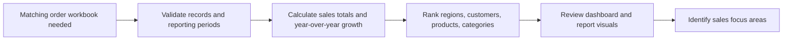
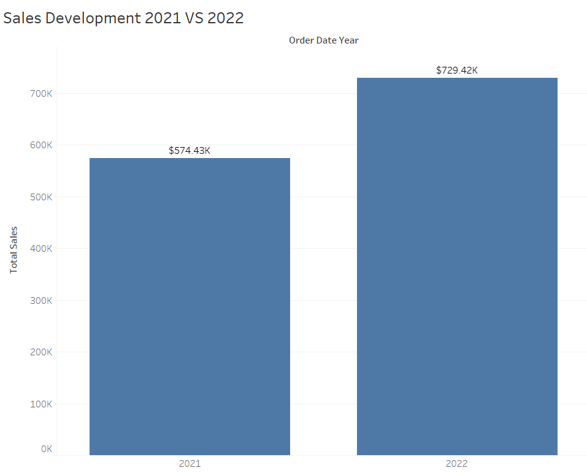
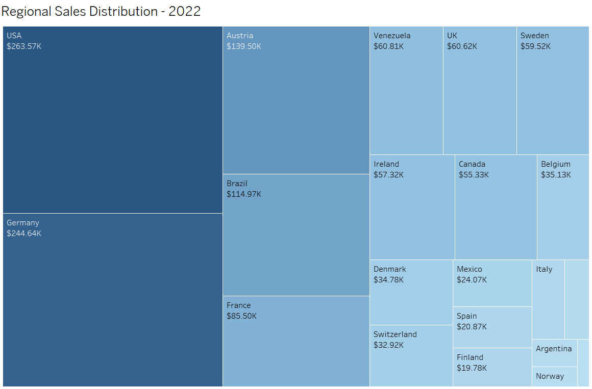
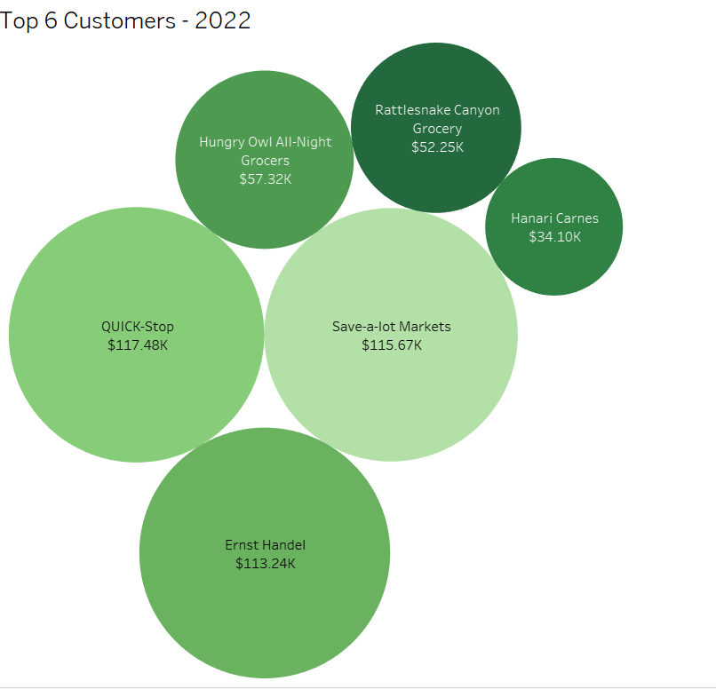
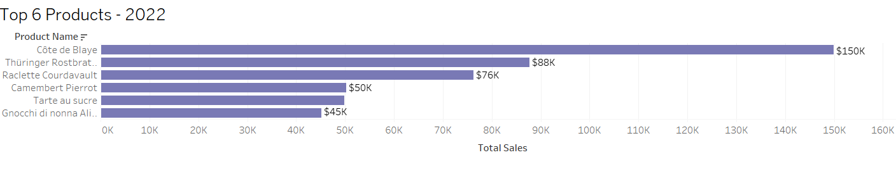
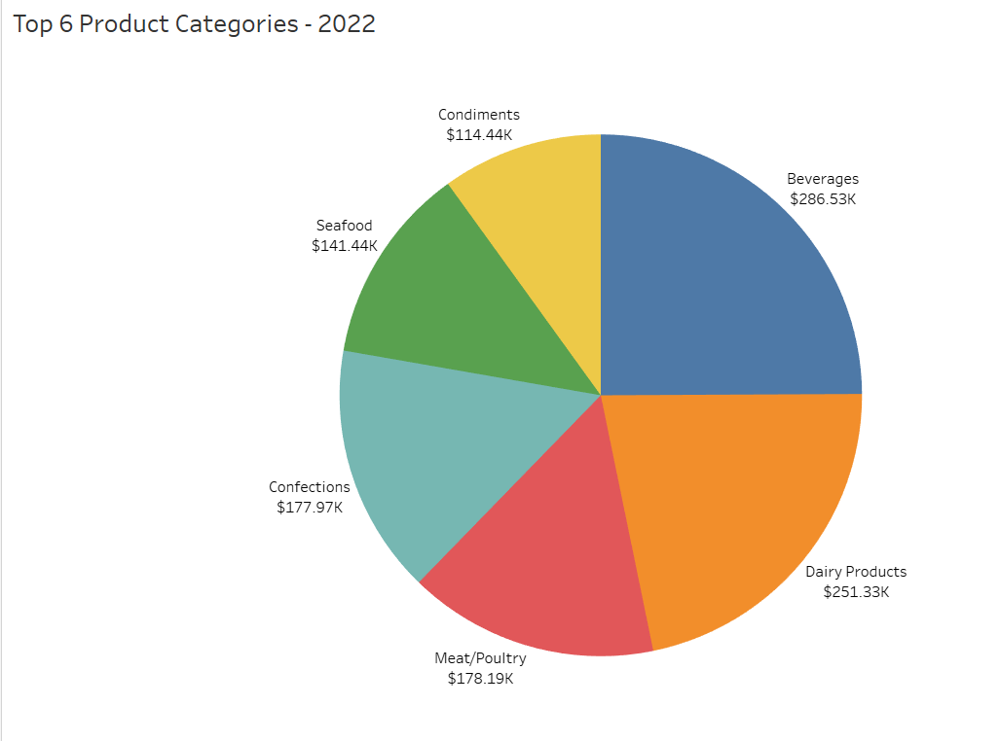

# Sales Performance Analysis — 2022

**Positioning:** Sales Analytics | **Source:** project report and dashboard images; matching Excel file still needed

## Executive summary
Sales increased from **$574.43K** in 2021 to **$729.42K** in 2022, or approximately **27%** year over year. The dashboard ranks customers and products by sales and compares regional and category contributions.

## Business question and pipeline
How did sales change in 2022, and which customers, products, categories, and regions contributed most?

## Business KPIs

| Metric | Formula | Reported value | Interpretation |
|---|---|---:|---|
| Total sales | `SUM([Product_Order_Price_Total])` | 2021 **$574.43K**; 2022 **$729.42K** | Total sales value for each year in the report. Currency is shown as `$`; the source workbook is still needed to confirm data and aggregation. |
| Year-over-year growth | `(2022 sales − 2021 sales) ÷ 2021 sales × 100` | `($729.42K − $574.43K) ÷ $574.43K` = **26.97% (~27%)** | Relative increase over 2021; does not identify the cause or indicate margin growth. |
| Customer sales | `SUM([Product_Order_Price_Total])` grouped by customer, filtered to 2022, then rank descending | QUICK-Stop **$117.48K**; Save-a-lot **$115.67K**; Ernst Handel **$113.24K**; Hungry Owl **$57.32K**; Rattlesnake Canyon **$52.25K**; Hanari Carnes **$34.10K** | Highlights 2022 revenue concentration among the six highest-sales customers; not customer profitability. |
| Regional sales | `SUM([Product_Order_Price_Total])` grouped by region | USA **$263.57K**; Germany **$244.64K**; Austria **$139.50K** | Indicates where reported sales are concentrated. |
| Category sales | `SUM([Product_Order_Price_Total])` grouped by category | Beverages **$286.53K**; Dairy **$251.33K**; Meat/Poultry **$178.19K**; Confections **$177.97K**; Seafood **$141.44K**; Condiments **$114.44K** | Compares category contribution to sales; not contribution margin. |
| Product sales | Same sales sum grouped by product; top six in 2022 | Côte de Blaye **~$150K**; Thüringer Rostbratwurst **~$88K**; Raclette Courdavault **~$76K**; Camembert Pierrot **~$50K**; Tarte au sucre **~$50K**; Gnocchi di nonna Alice **~$45K** | Ranks products by sales value, not units or profit. |

## Model Metrics

No predictive or statistical model is reported; this is a descriptive dashboard. Accuracy, AUC, and prediction error are **not applicable** to the current analysis.

## Insights
- 2022 sales were about 27% above 2021.
- USA and Germany were the largest displayed regional totals.
- Beverages and Dairy were the largest displayed categories; top-customer sales are concentrated in six accounts.
- The report and `.twb` identify `Product_Order_Price_Total` as the ranking metric, but the external source workbook is missing, so the figures remain report-reported until reconciled.

## Selected report visuals

## Recommendations
1. Validate the reported totals against the matching Excel source and confirm the sales period and currency.
2. Protect and review the six leading customer relationships while also tracking concentration risk.
3. Use category and product sales to guide follow-up on assortment and availability; pair sales with margin before allocating spend or inventory.
4. Investigate regional growth drivers rather than assuming the largest market has the best profitability.

## Evidence and proposed structure
- No packaged `.twbx` or matching Excel source was found. The source `.twb` references an external file path and is not included.
- Dashboard and chart screenshots from `BI Homework Assignment-4 Vaishnavi Amruthala.docx`: [`assets/`](assets/)
- Proposed repo tree: `README.md`, `assets/`, `workbook/`, `data/` (add workbook and data after the matching Excel source is supplied).

The report supports the executive summary, chart scope, and managerial questions; it does not provide formal stakeholder roles or an As-Is process.

## Supporting documents

- [Executive summary](docs/Executive-Summary.md)
- [Business requirements summary](docs/BRD-Summary.md)
- [Functional requirements summary](docs/FRD-Summary.md)

The source reports do not document an existing-state (As-Is) process; none is presented as fact.

